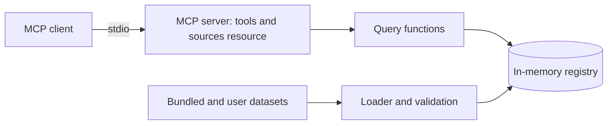

# nutrition-mcp

Work in progress. The server and its five tools run over stdio; the evaluations and the demo come next. This README fills in as each part ships; the reasoning behind the project is in the [case study](docs/case-study.md).

An MCP server that gives any assistant or agent sourced nutrition, glycemic load and micronutrient data for Indian dishes and ingredients, for any amount in grams or household measures.

[](https://github.com/Varun-Kambali/nutrition-mcp/actions/workflows/ci.yml) [](LICENSE) · **[Case study](docs/case-study.md)**

Demo: not recorded yet.

## Problem

Assistants answer nutrition questions about Indian food from memory, with no source and no stated portion, and they often add up a meal wrongly. That matters most for people managing diabetes or a nutrient deficiency. The authoritative Indian tables can't be redistributed, and the largest open database has few Indian dishes. Details are in the [case study](docs/case-study.md).

## Solution

- Search for Indian dishes and ingredients by name, including spelling variants.
- Nutrition for an amount in grams or household measures such as a katori or a roti, with the source and the assumed portion stated.
- Meal totals, and rankings of foods by any nutrient.
- Glycemic load where an openly licensed value exists, and missing, never guessed, where it doesn't.
- Daily calorie and protein targets, labelled as estimates.

The full list of planned features is in [docs/requirements.md](docs/requirements.md).

## Results

Not measured yet. The table will come from `evals/results/summary.md` once the evaluations have run.

## Architecture



The server reads dataset folders at startup, validates them, computes each dish's nutrition from its ingredients, and answers tool calls from memory. The longer description is in [docs/architecture.md](docs/architecture.md).

## Tech stack

| Layer | Choice | Why |
|---|---|---|
| Language and tooling | Python 3.12, uv, ruff, mypy, pytest | One toolchain for build, lint, types and tests |
| Protocol | MCP Python SDK 2.x | Typed tools over stdio for any MCP client |
| Data models | Pydantic | Validation at every boundary |
| Name matching | rapidfuzz | Fuzzy matching for spelling variants |
| CI | GitHub Actions | Lint, tests, image build and secret scan on every push |

## Quickstart

```bash
git clone https://github.com/Varun-Kambali/nutrition-mcp && cd nutrition-mcp
make setup
make test
```

`make run` starts the server on stdio, where it waits for an MCP client. Normally the client starts it for you: see [Use it](#use-it).

## Use it

The server runs on your machine and your MCP client starts it. It needs [uv](https://docs.astral.sh/uv/). Run it straight from GitHub with `uvx`, or from a clone with `uv`.

**Claude Desktop.** Add the server to `claude_desktop_config.json` (on macOS in `~/Library/Application Support/Claude/`, on Windows in `%APPDATA%\Claude\`), then restart the app.

From GitHub:

```json
{
  "mcpServers": {
    "nutrition": {
      "command": "uvx",
      "args": ["--from", "git+https://github.com/Varun-Kambali/nutrition-mcp", "nutrition-mcp"]
    }
  }
}
```

From a clone:

```json
{
  "mcpServers": {
    "nutrition": {
      "command": "uv",
      "args": ["--directory", "/path/to/nutrition-mcp", "run", "nutrition-mcp"]
    }
  }
}
```

If Claude Desktop cannot find `uv` or `uvx`, put its full path in `command` (`which uvx` prints it).

**Claude Code.**

```bash
# From GitHub
claude mcp add nutrition -- uvx --from git+https://github.com/Varun-Kambali/nutrition-mcp nutrition-mcp
# From a clone
claude mcp add nutrition -- uv --directory /path/to/nutrition-mcp run nutrition-mcp
```

Then ask, for example, "protein and carbs in 2 rotis and a katori of rajma?". The tool descriptions tell the model to find the food ids with `search_food` and take the totals from `compute_meal`.

Every tool is read-only:

| Tool or resource | What it gives |
|---|---|
| `search_food(query, region?, diet?, kind?, limit?)` | Food ids by name, spelling variants included, with kind, regions, diet and household measures. `total` counts every match before `limit`. A dish that is not in the data returns no results and close names as suggestions |
| `get_nutrition(food_id, amount, unit)` | Nutrients for an amount in grams or a household measure, with the grams used, the measure and oil assumptions, glycemic load when the GI is known, and the sources |
| `compute_meal(items)` | Per-item and total nutrients and glycemic load for 1 to 30 items, each a food id, amount and unit |
| `find_foods(rank_by, per?, region?, diet?, kind?, limit?)` | Foods ranked by one nutrient or by glycemic load, per 100 kcal, 100 g or serving |
| `compute_targets(sex, age, height_cm, weight_kg, activity, goal)` | Estimated daily calorie and protein targets for an adult, from the Mifflin-St Jeor equation |
| `nutrition://sources` (resource) | Every loaded data source with its URL, license, version and attribution |

Nutrient values are rounded to 2 decimals, so 0.0 can be a small amount; a value the source does not report is null, never 0. The details given to `compute_targets` pass through the model your client uses before they reach the server. The server stores nothing and does not log tool inputs. Logs are JSON lines on stderr; `NUTRITION_MCP_LOG_LEVEL` sets the level (default `INFO`).

## Evaluation

Two evaluations are planned: computed dish values against independent reference tables, and a model's accuracy with and without the tools. Neither has been run.

## Testing

`make test` and `make lint`. CI runs both and builds the Docker image.

## Deployment

The server runs on the user's machine over stdio. There is no hosted endpoint.

## Project structure

```
src/nutrition_mcp/   server code
tests/               unit and integration tests
docs/                case study, requirements, architecture
```

## Design decisions

Decision records will be listed here, one line each, as they are written in `docs/decisions/`.

## Limitations and next steps

The evaluations have not run, so there are no measured results yet. Known limits of the design are in the case study.

## What I learned

Written as the build goes.

## License and data

The code is MIT. The bundled ingredient table comes from USDA FoodData Central (public domain) and CoFID 2021 (Open Government Licence v3.0); glycemic index values come from a compendium of GI values for non-Western foods (CC BY 4.0). The license and attribution for each data file are in [`src/nutrition_mcp/data/bundled/LICENSE.md`](src/nutrition_mcp/data/bundled/LICENSE.md), and the nutrient mappings are in [`docs/data.md`](docs/data.md).
