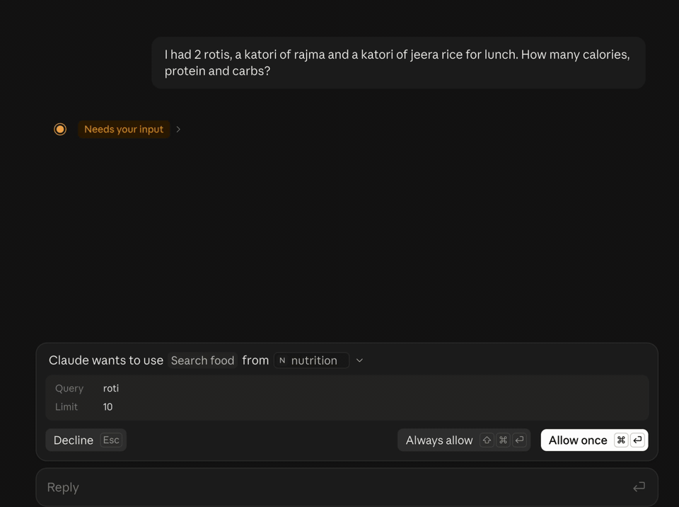
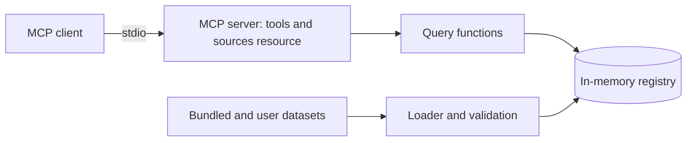

# nutrition-mcp

An MCP server that gives any assistant or agent sourced nutrition, glycemic load and micronutrient data for Indian dishes and ingredients, for any amount in grams or household measures.

[](https://github.com/Varun-Kambali/nutrition-mcp/actions/workflows/ci.yml) [](LICENSE) · **[Case study](docs/case-study.md)**



A lunch question in Claude Desktop, with the tool approvals sped up. The model looks up each food with `search_food`, then sends all three to `compute_meal`, and every number in the table comes from that call. One line below the table misreads the server: "the rice assumes about 15 g of ghee" is the whole pot. The tool says "15 g ghee, under 4 g per serving".

## Problem

Assistants answer nutrition questions about Indian food from memory, with no source and no stated portion, and they often add up a meal wrongly. That matters most for people managing diabetes or a nutrient deficiency. The authoritative Indian tables can't be redistributed, and the largest open database has few Indian dishes. Details are in the [case study](docs/case-study.md).

## Solution

- Search for Indian dishes and ingredients by name, including spelling variants.
- Nutrition for an amount in grams or household measures such as a katori or a roti, with the source and the assumed portion stated.
- Meal totals, and rankings of foods by any nutrient.
- Glycemic load where an openly licensed value exists, and missing, never guessed, where it doesn't.
- Daily calorie and protein targets, labelled as estimates.

Every feature, with what it must do, is in [docs/requirements.md](docs/requirements.md).

## Results

Two evaluations, kept apart ([ADR 0006](docs/decisions/0006-two-evaluations.md)). The rows below are copied from [`evals/results/summary.md`](evals/results/summary.md), and each row names its results file.

**Grounding.** A Gemini model answered 30 questions twice with the same prompt: from memory (Baseline) and with this server's tools over stdio (This project). Each golden answer is the server's own total for the foods in the question, and 4 of the questions name a dish that is not in the data. The error is the mean absolute percentage error (MAPE) over the 26 questions that both runs answered with numbers. Shares run from 0 to 1, and n is the number of questions behind each value, Baseline first, or the number of tool calls for tool errors and latency.

| Measure | Baseline | This project | n | Model | Date | Commit | Dataset version | Results file |
|---|---|---|---|---|---|---|---|---|
| Calorie error against the dataset totals, MAPE (%) | 16.0 | 0.0 | 26 / 26 | gemini-3.1-flash-lite | 2026-10-21 | 8262476 | 24143edbb56e | [2026-10-21_gemini-3.1-flash-lite_8262476.json](evals/results/2026-10-21_gemini-3.1-flash-lite_8262476.json) |
| Protein error against the dataset totals, MAPE (%) | 13.2 | 0.0 | 26 / 26 | gemini-3.1-flash-lite | 2026-10-21 | 8262476 | 24143edbb56e | [2026-10-21_gemini-3.1-flash-lite_8262476.json](evals/results/2026-10-21_gemini-3.1-flash-lite_8262476.json) |
| Carbohydrate error against the dataset totals, MAPE (%) | 20.2 | 0.0 | 26 / 26 | gemini-3.1-flash-lite | 2026-10-21 | 8262476 | 24143edbb56e | [2026-10-21_gemini-3.1-flash-lite_8262476.json](evals/results/2026-10-21_gemini-3.1-flash-lite_8262476.json) |
| Answers within 10% on calories (share) | 0.38 | 1.0 | 26 / 26 | gemini-3.1-flash-lite | 2026-10-21 | 8262476 | 24143edbb56e | [2026-10-21_gemini-3.1-flash-lite_8262476.json](evals/results/2026-10-21_gemini-3.1-flash-lite_8262476.json) |
| Missing dishes reported (share) | n/a | 0.5 | n/a / 4 | gemini-3.1-flash-lite | 2026-10-21 | 8262476 | 24143edbb56e | [2026-10-21_gemini-3.1-flash-lite_8262476.json](evals/results/2026-10-21_gemini-3.1-flash-lite_8262476.json) |
| Failed answers (count) | 0 | 1 | 30 / 30 | gemini-3.1-flash-lite | 2026-10-21 | 8262476 | 24143edbb56e | [2026-10-21_gemini-3.1-flash-lite_8262476.json](evals/results/2026-10-21_gemini-3.1-flash-lite_8262476.json) |
| API errors (count) | 0 | 0 | 30 / 30 | gemini-3.1-flash-lite | 2026-10-21 | 8262476 | 24143edbb56e | [2026-10-21_gemini-3.1-flash-lite_8262476.json](evals/results/2026-10-21_gemini-3.1-flash-lite_8262476.json) |
| Tool errors (count) | n/a | 0 | n/a / 89 | gemini-3.1-flash-lite | 2026-10-21 | 8262476 | 24143edbb56e | [2026-10-21_gemini-3.1-flash-lite_8262476.json](evals/results/2026-10-21_gemini-3.1-flash-lite_8262476.json) |
| p95 tool latency (ms) | n/a | 10.4 | n/a / 89 | gemini-3.1-flash-lite | 2026-10-21 | 8262476 | 24143edbb56e | [2026-10-21_gemini-3.1-flash-lite_8262476.json](evals/results/2026-10-21_gemini-3.1-flash-lite_8262476.json) |

The 0.0 is by construction. The golden answers are the server's own totals, so it shows that with the tools the model picked the right food and unit and used the computed total on every one of the 26 questions; it does not show that the totals match what the dishes contain, which the data-accuracy rows below measure against independent records. The Baseline error is also distance from those totals, not from the dishes. The 0.5 for missing dishes and the one failed answer come from the 4 questions about dishes that are not in the data; see Limitations.

**Data accuracy.** The suite compares the values the server computes for each dish, per 100 g, with an independent record of the same dish: a CoFID 2021 homemade dish or a USDA survey food. The value is the MAPE against those records, and n is the number of dishes compared. A gated nutrient fails CI when it gets worse than `evals/thresholds.toml` allows.

| Suite | Measure | n | Value | Date | Commit | Dataset version | Results file |
|---|---|---|---|---|---|---|---|
| data accuracy | Energy (kcal) MAPE (%), gated | 18 | 18.7 | 2026-10-20 | 32aa03d | 24143edbb56e | [2026-10-20_data-accuracy_32aa03d.json](evals/results/2026-10-20_data-accuracy_32aa03d.json) |
| data accuracy | Protein (g) MAPE (%), gated | 18 | 24.8 | 2026-10-20 | 32aa03d | 24143edbb56e | [2026-10-20_data-accuracy_32aa03d.json](evals/results/2026-10-20_data-accuracy_32aa03d.json) |
| data accuracy | Available carbohydrate (g) MAPE (%), gated | 18 | 16.7 | 2026-10-20 | 32aa03d | 24143edbb56e | [2026-10-20_data-accuracy_32aa03d.json](evals/results/2026-10-20_data-accuracy_32aa03d.json) |
| data accuracy | Iron (mg) MAPE (%), reported | 18 | 44.2 | 2026-10-20 | 32aa03d | 24143edbb56e | [2026-10-20_data-accuracy_32aa03d.json](evals/results/2026-10-20_data-accuracy_32aa03d.json) |
| data accuracy | Calcium (mg) MAPE (%), reported | 18 | 46.1 | 2026-10-20 | 32aa03d | 24143edbb56e | [2026-10-20_data-accuracy_32aa03d.json](evals/results/2026-10-20_data-accuracy_32aa03d.json) |

The references are UK and US records, so part of each error is a difference in recipe (water, fat, an enriched grain) or in energy basis rather than wrong data; ADR 0006 names the largest cases.

## Architecture



The server reads dataset folders at startup, validates them, computes each dish's nutrition from its ingredients, and answers tool calls from memory. The longer description is in [docs/architecture.md](docs/architecture.md).

## Tech stack

| Layer | Choice | Why |
|---|---|---|
| Language and tooling | Python 3.12, uv, ruff, mypy, pytest | One toolchain for build, lint, types and tests |
| Protocol | MCP Python SDK 2.x | Typed tools over stdio for any MCP client |
| Data models | Pydantic | Validation at every boundary |
| Name matching | rapidfuzz | Fuzzy matching for spelling variants |
| Container | Docker | A slim image that runs as a non-root user; CI builds it and calls its tools |
| CI | GitHub Actions | Lint, tests, image build and secret scan on every push |

## Quickstart

```bash
git clone https://github.com/Varun-Kambali/nutrition-mcp && cd nutrition-mcp
make setup
make test
```

`make run` starts the server on stdio, where it waits for an MCP client. Normally the client starts it for you: see [Use it](#use-it).

## Use it

The server runs on your machine and your MCP client starts it. It needs [uv](https://docs.astral.sh/uv/). Run it straight from GitHub with `uvx`, or from a clone with `uv`.

**Claude Desktop.** Add the server to `claude_desktop_config.json` (on macOS in `~/Library/Application Support/Claude/`, on Windows in `%APPDATA%\Claude\`), then restart the app.

From GitHub:

```json
{
  "mcpServers": {
    "nutrition": {
      "command": "uvx",
      "args": ["--from", "git+https://github.com/Varun-Kambali/nutrition-mcp", "nutrition-mcp"]
    }
  }
}
```

From a clone:

```json
{
  "mcpServers": {
    "nutrition": {
      "command": "uv",
      "args": ["--directory", "/path/to/nutrition-mcp", "run", "nutrition-mcp"]
    }
  }
}
```

If Claude Desktop cannot find `uv` or `uvx`, put its full path in `command` (`which uvx` prints it).

**Claude Code.**

```bash
# From GitHub
claude mcp add nutrition -- uvx --from git+https://github.com/Varun-Kambali/nutrition-mcp nutrition-mcp
# From a clone
claude mcp add nutrition -- uv --directory /path/to/nutrition-mcp run nutrition-mcp
```

Then ask, for example, "protein and carbs in 2 rotis and a katori of rajma?". The tool descriptions tell the model to find the food ids with `search_food` and take the totals from `compute_meal`.

The five tools, all read-only, and the sources resource:

| Tool or resource | What it gives |
|---|---|
| `search_food(query, region?, diet?, kind?, limit?)` | Food ids by name, spelling variants included, with kind, regions, diet and the units the food accepts (grams in one katori, piece, glass and so on). `total` counts every match before `limit`. Every word of the query has to match a name, so a dish that is not in the data returns no results and close names as suggestions |
| `get_nutrition(food_id, amount, unit)` | Nutrients for an amount in grams or a household measure, with the grams used, the measure and oil assumptions, glycemic load when the GI is known, and the sources |
| `compute_meal(items)` | Per-item and total nutrients and glycemic load for 1 to 30 items, each a food id, amount and unit |
| `find_foods(rank_by, per?, region?, diet?, kind?, limit?)` | Foods ranked by one nutrient or by glycemic load, per 100 kcal, 100 g or serving |
| `compute_targets(sex, age, height_cm, weight_kg, activity, goal)` | Estimated daily calorie and protein targets for an adult, from the Mifflin-St Jeor equation |
| `nutrition://sources` (resource) | Every loaded data source with its URL, license, version and attribution |

Nutrient values are rounded to 2 decimals, so 0.0 can be a small amount; a value the source does not report is null, never 0. The details given to `compute_targets` pass through the model your client uses before they reach the server. The server stores nothing and does not log tool inputs. Logs are JSON lines on stderr; `NUTRITION_MCP_LOG_LEVEL` sets the level: `DEBUG`, `INFO` (the default), `WARNING`, `ERROR` or `CRITICAL`.

## Your own data

The bundled data is a starting point. A team with a licensed food table or lab-tested recipes can load its own folders next to it, with no change to the tools. List the folders in `NUTRITION_MCP_DATA_DIRS`, separated by `:` (`;` on Windows), in the `env` of the client config:

```json
{
  "mcpServers": {
    "nutrition": {
      "command": "uvx",
      "args": ["--from", "git+https://github.com/Varun-Kambali/nutrition-mcp", "nutrition-mcp"],
      "env": { "NUTRITION_MCP_DATA_DIRS": "/path/to/my-data" }
    }
  }
}
```

A folder has the same three parts as the bundled data, each with a JSON Schema:

| File | Holds | Schema |
|---|---|---|
| `sources.yaml` | Each source: id, name, URL, license, version, retrieval date and attribution | [`schemas/sources.json`](schemas/sources.json) |
| `ingredients.csv` | One row per ingredient: names, diet, source and record, and the 16 nutrients per 100 g, with an empty cell for a value the source does not report | [`schemas/ingredient.json`](schemas/ingredient.json) |
| `dishes/<id>.yaml` | One recipe per file: raw grams of each ingredient, cooked weight, servings, regions, diet, household measures and the fat assumption | [`schemas/dish.json`](schemas/dish.json) |

A dish can use the bundled ingredients, so `ingredients.csv` may hold only its header. Leave water out of a recipe: `cooked_weight_g` accounts for it. For example, `dishes/office_dal.yaml`:

```yaml
id: office_dal
name: Office canteen dal
aliases: [canteen dal]
regions: [south]
diet: veg
servings: 4
cooked_weight_g: 800
ingredients:
  - ingredient_id: toor_dal
    grams: 150
  - ingredient_id: ghee
    grams: 20
measures:
  katori: 180
assumptions: 5 g ghee per serving in the tadka.
source_id: my_kitchen
```

The server computes the dish's nutrition from its ingredients, as it does for the bundled dishes. A bad row, an unknown ingredient or an id that is already loaded stops startup with an error on stderr that names the file. The fields are described in [docs/architecture.md](docs/architecture.md#data-format-bundled-and-custom).

## Evaluation

Two evaluations, kept apart because one checks the data and the other checks a model using it ([ADR 0006](docs/decisions/0006-two-evaluations.md)):

- **Data accuracy** compares computed dish values with independent records of the same dishes (`evals/datasets/references.csv`, built from `data_build/reference_map.csv` by `scripts/build_references.py`). It needs no model and no API key. Run it with `make eval-data`; CI runs it on every pull request with `--check` against `evals/thresholds.toml`. The latest result is under Results.
- **Grounding** asks a Gemini model each question in `evals/datasets/questions.jsonl` twice with the same task prompt: once from memory, and once with this server's tools over stdio and the instructions the server sends when a client connects ([ADR 0007](docs/decisions/0007-missing-food-note-and-server-instructions.md)). Each question lists the food ids, amounts and units behind it, and its golden answer comes from the server's own query functions; a few ask about dishes that are not in the data, where the right answer names the dish as missing. The model ends its reply with a JSON answer, so scoring needs no judge model. A run reports the error against the dataset totals (the mean absolute percentage error on kcal, protein and available carbohydrate, over the questions both runs answered with numbers), the share of answers within 10%, the missing dishes reported, failed answers, API and tool errors and p95 tool latency, and writes them to a results file named by date, model and commit. It calls the model, so it runs only on demand: put `GEMINI_API_KEY` in `.env` (see `.env.example`) and run `make eval`. `EVAL_MODEL` overrides the default model set in `evals/grounding.py`. Requests start at least 4 seconds apart by default. That is a conservative default, not a published limit: Google shows free-tier rate limits per project in AI Studio. `make eval ARGS="--min-interval 2"` changes the gap, and `make eval ARGS="--limit 2 --out /tmp/smoke"` asks only the first two questions to check the setup; a run with `--limit` never replaces the headline. The first full run is under Results.

## Testing

`make test` and `make lint`. CI runs both, checks data accuracy against `evals/thresholds.toml`, and builds the Docker image, then starts it the way an MCP client would and calls the tools (`tests/integration/test_container.py`, which skips unless `NUTRITION_MCP_IMAGE` names a built image).

## Deployment

The server runs on the user's machine: the MCP client starts it and talks to it over stdio, so there is nothing to host and no demo endpoint. A remote server with authentication, rate limits and a spend cap is outside v1 ([requirements](docs/requirements.md#non-goals-for-v1)).

To run it in a container, build the image with `docker build -t nutrition-mcp .` in a clone, then give the client `docker` as the command and `["run", "-i", "--rm", "nutrition-mcp"]` as the arguments.

## Project structure

```
src/nutrition_mcp/           server, loader, queries and search
src/nutrition_mcp/data/      bundled dataset, with its sources and licenses
schemas/                     JSON Schemas for a dataset folder
evals/                       evaluation runners, datasets and results
data_build/, scripts/        the reviewed maps and scripts that build the bundled data
tests/                       unit and integration tests, and the container test
docs/                        case study, requirements, architecture, data notes, decisions
```

## Design decisions

- [0001](docs/decisions/0001-own-recipes-over-copied-tables.md): write the dish recipes for this project and take ingredient values only from openly licensed tables, because the Indian food tables cannot be redistributed.
- [0002](docs/decisions/0002-data-sources.md): USDA FoodData Central first, CoFID 2021 where USDA lacks the food or has it only in the wrong form.
- [0003](docs/decisions/0003-missing-is-not-zero.md): a value the source does not report stays null, and a dish total that lacks one names the ingredients behind the gap.
- [0004](docs/decisions/0004-facts-not-people.md): the server answers questions about food and stores nothing about the person; condition-aware logic belongs to the planner.
- [0005](docs/decisions/0005-targets-formula.md): calorie and protein targets from Mifflin-St Jeor, each constant cited, with the limits of the estimate.
- [0006](docs/decisions/0006-two-evaluations.md): two evaluations, because grounding scores a model against the bundled data and cannot catch wrong data; data accuracy compares computed dishes with independent records and gates CI.
- [0007](docs/decisions/0007-missing-food-note-and-server-instructions.md): an empty search result says the food is not in the data and is to be reported as missing, and the grounding run passes the server's instructions to the model as a client would.

## Limitations and next steps

The grounding result is one run of one model, on the free tier. Its model runs at the provider's default temperature, as Google advises for Gemini 3 models, so its answers, and the numbers built on them, vary from run to run. Its with-tools run passed the model the server's tools but not the instructions the server sends when a client connects, which tell the model to get food ids from `search_food`, use `get_nutrition` or `compute_meal`, and take every number from a tool result. For clients that pass those instructions on to the model, the measured gain is a lower bound. The harness now passes them ([ADR 0007](docs/decisions/0007-missing-food-note-and-server-instructions.md)), so the next run measures the server as such a client uses it.

Two behaviours with dishes that are not in the data, as observed in the recorded run. For pulao the model searched 5 times and found no pulao, then answered with the numbers for jeera rice. That is a substitution, the behaviour the requirements list as a failure. The data has no pulao, so the choice of another food was the model's, and this run did not pass the server's instructions, so it does not show whether they change it. For masala dosa the model made 7 searches for the dosa and its filling and reached the 8-turn cap without an answer, which is the one failed answer in the table. Only chicken curry and kheer were reported as missing. Since that run, an empty search result carries a note that says the food is not in the data and is to be reported as missing instead of answered with another food ([ADR 0007](docs/decisions/0007-missing-food-note-and-server-instructions.md)). A new run is needed to show whether that changes either behaviour.

Search reads a plural by trying the query again without the final "s" when it finds nothing as typed, so "rotis", "plain dosas" and "batata vadas" find their dish. Irregular plurals and plurals in other languages are not handled. The data-accuracy evaluation covers only the dishes that have an independent record (n under Results); ADR 0006 lists the others and why they have none. Known limits of the design are in the case study.

## What I learned

- **A tool description is read once; a tool result is read when the model decides.** The `search_food` description already said to report a missing dish, and in the first grounding run the model still answered pulao with jeera rice after four empty searches. The fix was to put the instruction in the empty result itself ([ADR 0007](docs/decisions/0007-missing-food-note-and-server-instructions.md)).
- **An evaluation scored against your own data cannot tell you the data is right.** With the tools, calorie error against the server's totals was 0.0, by construction. Checking the computed dishes against independent CoFID and USDA records gave 18.7% mean error on calories over 18 dishes, which is what the data-accuracy gate in CI now tracks ([ADR 0006](docs/decisions/0006-two-evaluations.md), [results file](evals/results/2026-10-20_data-accuracy_32aa03d.json)).
- **Fuzzy search needs word rules, not just a score.** A plain similarity score matched "tea" inside "steamed" and returned chana masala for "chicken curry" through its alias "chickpea curry". Requiring every query word to match a word of the name fixed both, and plurals came later as a retry in the singular ([search.py](src/nutrition_mcp/search.py)).
- **Two open food tables can mean different things by the same nutrient.** USDA reports carbohydrate by difference, fibre included; CoFID reports available carbohydrate and gives fibre no energy. Every source value is mapped to one definition before a dish is computed ([data notes](docs/data.md)).
- **Missing has to stay missing.** Urad dal has no fibre value in its source, so idli's fibre is reported as a lower bound with the ingredient named, not as a smaller number that looks complete ([ADR 0003](docs/decisions/0003-missing-is-not-zero.md)).

## License and data

The code is MIT. The bundled ingredient table comes from USDA FoodData Central (public domain) and CoFID 2021 (Open Government Licence v3.0); glycemic index values come from a compendium of GI values for non-Western foods (CC BY 4.0). The license and attribution for each data file are in [`src/nutrition_mcp/data/bundled/LICENSE.md`](src/nutrition_mcp/data/bundled/LICENSE.md), and the nutrient mappings are in [`docs/data.md`](docs/data.md).
