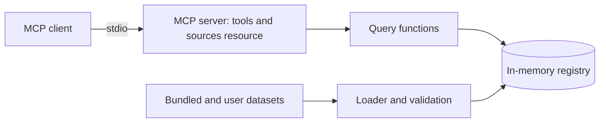

# nutrition-mcp

Work in progress. The server and its five tools run over stdio, and the data-accuracy evaluation runs in CI; the grounding evaluation and the demo come next. This README fills in as each part ships; the reasoning behind the project is in the [case study](docs/case-study.md).

An MCP server that gives any assistant or agent sourced nutrition, glycemic load and micronutrient data for Indian dishes and ingredients, for any amount in grams or household measures.

[](https://github.com/Varun-Kambali/nutrition-mcp/actions/workflows/ci.yml) [](LICENSE) · **[Case study](docs/case-study.md)**

Demo: not recorded yet.

## Problem

Assistants answer nutrition questions about Indian food from memory, with no source and no stated portion, and they often add up a meal wrongly. That matters most for people managing diabetes or a nutrient deficiency. The authoritative Indian tables can't be redistributed, and the largest open database has few Indian dishes. Details are in the [case study](docs/case-study.md).

## Solution

- Search for Indian dishes and ingredients by name, including spelling variants.
- Nutrition for an amount in grams or household measures such as a katori or a roti, with the source and the assumed portion stated.
- Meal totals, and rankings of foods by any nutrient.
- Glycemic load where an openly licensed value exists, and missing, never guessed, where it doesn't.
- Daily calorie and protein targets, labelled as estimates.

The full list of planned features is in [docs/requirements.md](docs/requirements.md).

## Results

The data-accuracy evaluation compares the values the server computes for each dish, per 100 g, with an independent record of the same dish: a CoFID 2021 homemade dish or a USDA survey food ([ADR 0006](docs/decisions/0006-two-evaluations.md)). The value is the mean absolute percentage error (MAPE) against those records, and n is the number of dishes compared. A gated nutrient fails CI when it gets worse than `evals/thresholds.toml` allows. The rows are copied from [`evals/results/summary.md`](evals/results/summary.md):

| Suite | Measure | n | Value | Date | Commit | Dataset version | Results file |
|---|---|---|---|---|---|---|---|
| data accuracy | Energy (kcal) MAPE (%), gated | 18 | 18.7 | 2026-10-20 | 32aa03d | 24143edbb56e | [2026-10-20_data-accuracy_32aa03d.json](evals/results/2026-10-20_data-accuracy_32aa03d.json) |
| data accuracy | Protein (g) MAPE (%), gated | 18 | 24.8 | 2026-10-20 | 32aa03d | 24143edbb56e | [2026-10-20_data-accuracy_32aa03d.json](evals/results/2026-10-20_data-accuracy_32aa03d.json) |
| data accuracy | Available carbohydrate (g) MAPE (%), gated | 18 | 16.7 | 2026-10-20 | 32aa03d | 24143edbb56e | [2026-10-20_data-accuracy_32aa03d.json](evals/results/2026-10-20_data-accuracy_32aa03d.json) |
| data accuracy | Iron (mg) MAPE (%), reported | 18 | 44.2 | 2026-10-20 | 32aa03d | 24143edbb56e | [2026-10-20_data-accuracy_32aa03d.json](evals/results/2026-10-20_data-accuracy_32aa03d.json) |
| data accuracy | Calcium (mg) MAPE (%), reported | 18 | 46.1 | 2026-10-20 | 32aa03d | 24143edbb56e | [2026-10-20_data-accuracy_32aa03d.json](evals/results/2026-10-20_data-accuracy_32aa03d.json) |

The references are UK and US records, so part of each error is a difference in recipe (water, fat, an enriched grain) or in energy basis rather than wrong data; ADR 0006 names the largest cases. The grounding evaluation, a model's accuracy with and without the tools, has not run yet. Its numbers will come from its own results file.

## Architecture



The server reads dataset folders at startup, validates them, computes each dish's nutrition from its ingredients, and answers tool calls from memory. The longer description is in [docs/architecture.md](docs/architecture.md).

## Tech stack

| Layer | Choice | Why |
|---|---|---|
| Language and tooling | Python 3.12, uv, ruff, mypy, pytest | One toolchain for build, lint, types and tests |
| Protocol | MCP Python SDK 2.x | Typed tools over stdio for any MCP client |
| Data models | Pydantic | Validation at every boundary |
| Name matching | rapidfuzz | Fuzzy matching for spelling variants |
| CI | GitHub Actions | Lint, tests, image build and secret scan on every push |

## Quickstart

```bash
git clone https://github.com/Varun-Kambali/nutrition-mcp && cd nutrition-mcp
make setup
make test
```

`make run` starts the server on stdio, where it waits for an MCP client. Normally the client starts it for you: see [Use it](#use-it).

## Use it

The server runs on your machine and your MCP client starts it. It needs [uv](https://docs.astral.sh/uv/). Run it straight from GitHub with `uvx`, or from a clone with `uv`.

**Claude Desktop.** Add the server to `claude_desktop_config.json` (on macOS in `~/Library/Application Support/Claude/`, on Windows in `%APPDATA%\Claude\`), then restart the app.

From GitHub:

```json
{
  "mcpServers": {
    "nutrition": {
      "command": "uvx",
      "args": ["--from", "git+https://github.com/Varun-Kambali/nutrition-mcp", "nutrition-mcp"]
    }
  }
}
```

From a clone:

```json
{
  "mcpServers": {
    "nutrition": {
      "command": "uv",
      "args": ["--directory", "/path/to/nutrition-mcp", "run", "nutrition-mcp"]
    }
  }
}
```

If Claude Desktop cannot find `uv` or `uvx`, put its full path in `command` (`which uvx` prints it).

**Claude Code.**

```bash
# From GitHub
claude mcp add nutrition -- uvx --from git+https://github.com/Varun-Kambali/nutrition-mcp nutrition-mcp
# From a clone
claude mcp add nutrition -- uv --directory /path/to/nutrition-mcp run nutrition-mcp
```

Then ask, for example, "protein and carbs in 2 rotis and a katori of rajma?". The tool descriptions tell the model to find the food ids with `search_food` and take the totals from `compute_meal`.

The five tools, all read-only, and the sources resource:

| Tool or resource | What it gives |
|---|---|
| `search_food(query, region?, diet?, kind?, limit?)` | Food ids by name, spelling variants included, with kind, regions, diet and the units the food accepts (grams in one katori, piece, glass and so on). `total` counts every match before `limit`. Every word of the query has to match a name, so a dish that is not in the data returns no results and close names as suggestions |
| `get_nutrition(food_id, amount, unit)` | Nutrients for an amount in grams or a household measure, with the grams used, the measure and oil assumptions, glycemic load when the GI is known, and the sources |
| `compute_meal(items)` | Per-item and total nutrients and glycemic load for 1 to 30 items, each a food id, amount and unit |
| `find_foods(rank_by, per?, region?, diet?, kind?, limit?)` | Foods ranked by one nutrient or by glycemic load, per 100 kcal, 100 g or serving |
| `compute_targets(sex, age, height_cm, weight_kg, activity, goal)` | Estimated daily calorie and protein targets for an adult, from the Mifflin-St Jeor equation |
| `nutrition://sources` (resource) | Every loaded data source with its URL, license, version and attribution |

Nutrient values are rounded to 2 decimals, so 0.0 can be a small amount; a value the source does not report is null, never 0. The details given to `compute_targets` pass through the model your client uses before they reach the server. The server stores nothing and does not log tool inputs. Logs are JSON lines on stderr; `NUTRITION_MCP_LOG_LEVEL` sets the level: `DEBUG`, `INFO` (the default), `WARNING`, `ERROR` or `CRITICAL`.

## Evaluation

Two evaluations, kept apart because one checks the data and the other checks a model using it ([ADR 0006](docs/decisions/0006-two-evaluations.md)):

- **Data accuracy** compares computed dish values with independent records of the same dishes (`evals/datasets/references.csv`, built from `data_build/reference_map.csv` by `scripts/build_references.py`). It needs no model and no API key. Run it with `make eval-data`; CI runs it on every pull request with `--check` against `evals/thresholds.toml`. The latest result is under Results.
- **Grounding** asks a Gemini model each question in `evals/datasets/questions.jsonl` twice with the same prompt: once from memory, and once with this server's tools over stdio. Each question lists the food ids, amounts and units behind it, and its golden answer comes from the server's own query functions; a few ask about dishes that are not in the data, where the right answer names the dish as missing. The model ends its reply with a JSON answer, so scoring needs no judge model. A run reports the error against the dataset totals (the mean absolute percentage error on kcal, protein and available carbohydrate, over the questions both runs answered with numbers), the share of answers within 10%, the missing dishes reported, failed answers, API and tool errors and p95 tool latency, and writes them to a results file named by date, model and commit. It calls the model, so it runs only on demand: put `GEMINI_API_KEY` in `.env` (see `.env.example`) and run `make eval`. `EVAL_MODEL` overrides the default model set in `evals/grounding.py`. Requests start at least 4 seconds apart by default. That is a conservative default, not a published limit: Google shows free-tier rate limits per project in AI Studio. `make eval ARGS="--min-interval 2"` changes the gap, and `make eval ARGS="--limit 2 --out /tmp/smoke"` asks only the first two questions to check the setup; a run with `--limit` never replaces the headline. It has not run yet.

## Testing

`make test` and `make lint`. CI runs both, checks data accuracy against `evals/thresholds.toml`, and builds the Docker image.

## Deployment

The server runs on the user's machine over stdio. There is no hosted endpoint.

## Project structure

```
src/nutrition_mcp/   server code
evals/               evaluation runner, datasets and results
tests/               unit and integration tests
docs/                case study, requirements, architecture
```

## Design decisions

- [0001](docs/decisions/0001-own-recipes-over-copied-tables.md): write the dish recipes for this project and take ingredient values only from openly licensed tables, because the Indian food tables cannot be redistributed.
- [0002](docs/decisions/0002-data-sources.md): USDA FoodData Central first, CoFID 2021 where USDA lacks the food or has it only in the wrong form.
- [0003](docs/decisions/0003-missing-is-not-zero.md): a value the source does not report stays null, and a dish total that lacks one names the ingredients behind the gap.
- [0004](docs/decisions/0004-facts-not-people.md): the server answers questions about food and stores nothing about the person; condition-aware logic belongs to the planner.
- [0005](docs/decisions/0005-targets-formula.md): calorie and protein targets from Mifflin-St Jeor, each constant cited, with the limits of the estimate.
- [0006](docs/decisions/0006-two-evaluations.md): two evaluations, because grounding scores a model against the bundled data and cannot catch wrong data; data accuracy compares computed dishes with independent records and gates CI.

## Limitations and next steps

The grounding evaluation has not run, so the gain from the tools is not measured yet. Its model runs at the provider's default temperature, as Google advises for Gemini 3 models, so its answers, and the numbers built on them, vary from run to run. Its with-tools run passes the model the server's tools but not the instructions the server sends when a client connects, which tell the model to get food ids from `search_food`, use `get_nutrition` or `compute_meal`, and take every number from a tool result. For clients that pass those instructions on to the model, the measured gain is a lower bound.

Search has no plural forms. A plural matches only as a one-letter slip, which search accepts on words of 5 letters or more, so "chapatis" finds chapati but "rotis", "plain dosas" and "batata vadas" return no results, only the singular name as a suggestion. The data-accuracy evaluation covers only the dishes that have an independent record (n under Results); ADR 0006 lists the others and why they have none. Known limits of the design are in the case study.

## What I learned

Written as the build goes.

## License and data

The code is MIT. The bundled ingredient table comes from USDA FoodData Central (public domain) and CoFID 2021 (Open Government Licence v3.0); glycemic index values come from a compendium of GI values for non-Western foods (CC BY 4.0). The license and attribution for each data file are in [`src/nutrition_mcp/data/bundled/LICENSE.md`](src/nutrition_mcp/data/bundled/LICENSE.md), and the nutrient mappings are in [`docs/data.md`](docs/data.md).
