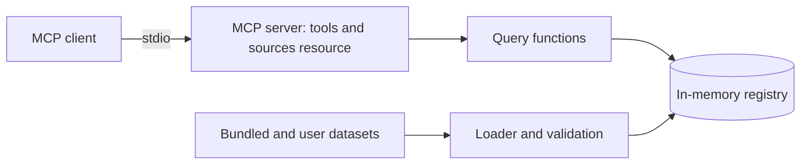

# nutrition-mcp

Work in progress. The server is not implemented yet. This README is a stub that fills in as each part ships; the reasoning behind the project is in the [case study](docs/case-study.md).

An MCP server that gives any assistant or agent sourced nutrition, glycemic load and micronutrient data for Indian dishes and ingredients, for any amount in grams or household measures.

[](https://github.com/Varun-Kambali/nutrition-mcp/actions/workflows/ci.yml) [](LICENSE) · **[Case study](docs/case-study.md)**

Demo: to be recorded once the server runs.

## Problem

Assistants answer nutrition questions about Indian food from memory, with no source and no stated portion, and they often add up a meal wrongly. That matters most for people managing diabetes or a nutrient deficiency. The authoritative Indian tables can't be redistributed, and the largest open database has few Indian dishes. Details are in the [case study](docs/case-study.md).

## Solution

- Search for Indian dishes and ingredients by name, including spelling variants.
- Nutrition for an amount in grams or household measures such as a katori or a roti, with the source and the assumed portion stated.
- Meal totals, and rankings of foods by any nutrient.
- Glycemic load where an openly licensed value exists, and missing, never guessed, where it doesn't.
- Daily calorie and protein targets, labelled as estimates.

The full list of planned features is in [docs/requirements.md](docs/requirements.md).

## Results

Not measured yet. The table will come from `evals/results/summary.md` once the evaluations have run.

## Architecture



The server reads dataset folders at startup, validates them, computes each dish's nutrition from its ingredients, and answers tool calls from memory. The longer description is in [docs/architecture.md](docs/architecture.md).

## Tech stack

| Layer | Choice | Why |
|---|---|---|
| Language and tooling | Python 3.12, uv, ruff, mypy, pytest | One toolchain for build, lint, types and tests |
| Protocol | MCP Python SDK 2.x | Typed tools over stdio for any MCP client |
| Data models | Pydantic | Validation at every boundary |
| Name matching | rapidfuzz | Fuzzy matching for spelling variants |
| CI | GitHub Actions | Lint, tests, image build and secret scan on every push |

## Quickstart

```bash
git clone https://github.com/Varun-Kambali/nutrition-mcp && cd nutrition-mcp
make setup
make test
```

`make run` exits with "not implemented" until the server lands. Client setup for Claude Desktop and Claude Code will be added here.

## Usage

Not available yet.

## Evaluation

Two evaluations are planned: computed dish values against independent reference tables, and a model's accuracy with and without the tools. Neither has been run.

## Testing

`make test` and `make lint`. CI runs both and builds the Docker image.

## Deployment

The server runs on the user's machine over stdio. There is no hosted endpoint.

## Project structure

```
src/nutrition_mcp/   server code
tests/unit/          unit tests
docs/                case study, requirements, architecture
```

## Design decisions

Decision records will be listed here, one line each, as they are written in `docs/decisions/`.

## Limitations and next steps

Nothing runs yet. Known limits of the finished design are in the case study.

## What I learned

Written as the build goes.

## License and data

The code is MIT. The bundled ingredient table comes from USDA FoodData Central (public domain) and CoFID 2021 (Open Government Licence v3.0); glycemic index values come from a compendium of GI values for non-Western foods (CC BY 4.0). The license and attribution for each data file are in [`src/nutrition_mcp/data/bundled/LICENSE.md`](src/nutrition_mcp/data/bundled/LICENSE.md), and the nutrient mappings are in [`docs/data.md`](docs/data.md).
