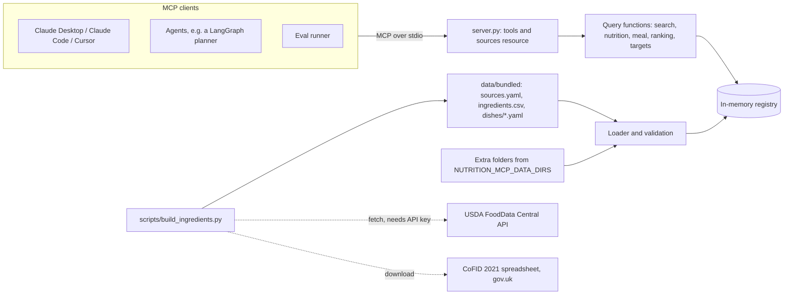

# Architecture

Status: draft, 2026-10-19. What the server must do is in [requirements.md](requirements.md); why it exists is in [case-study.md](case-study.md).

## Overview



There are three layers, and each one only talks to the layer below it:

1. **Data on disk.** Dataset folders in one documented format. The bundled folder ships in the repo, and users can add their own.
2. **Loader and registry.** Reads every folder at startup, validates it, computes dish nutrition and glycemic load, and keeps everything in memory. The data is small (about 100 foods), so a database would add nothing.
3. **MCP layer.** Registers the tools and the resource on an `MCPServer` (MCP Python SDK 2.x) and turns query results into structured tool output.

The server makes no network calls at runtime. Only the build script talks to USDA and downloads CoFID; its output CSV is committed, and the raw CoFID spreadsheet is not.

## Modules (`src/nutrition_mcp/`)

| Module | Responsibility |
|---|---|
| `models.py` | Pydantic models for dataset files and the registry: `Source`, `Ingredient`, `Dish`, `RecipeItem`, `Nutrients` (the 16 nutrients, each optional so missing stays missing) and `Food` (an ingredient or a dish as the queries see it). Also the `Diet`, `Region` and `Kind` types and `DIET_SUITABLE_FOR`, which says which diet tags a diet filter keeps |
| `config.py` | Settings from the environment through `pydantic-settings`: extra data folders, default katori size, log level |
| `loader.py` | Reads dataset folders, validates rows, resolves dish ingredients, computes dish nutrients per 100 g, and fails loudly with file and row |
| `registry.py` | In-memory store keyed by food ID and source ID. Search scans the foods on each call, because there are only about 100 of them |
| `search.py` | `search_foods`: the shared filters from `queries.py` first, then name normalisation (case, accents, common transliteration variants such as "bh"/"b" and doubled vowels) and fuzzy scoring with `rapidfuzz` over each food's name, aliases and ID. A name scores `token_set_ratio` only when it holds every word of the query (the subset rule), and whole-string `ratio` otherwise. A food is a result only when one of its names passes a word gate and scores at least 80: every query word must equal a word of that name, or be one edit away from it when both words have 5 or more letters and the same first letter. The gate keeps a dish that is not in the data from returning a different one ("chicken curry" no longer returns chana masala through its alias "chickpea curry"). The score orders the results and picks the suggestions. `SearchResult.total` counts the results before `limit` cuts the list. Close names come back as suggestions only when there are no results, and a food that fails the gate can still be one |
| `units.py` | Turns an amount and unit into grams for a given food, using the food's own measures first and the defaults second (the default katori for a dish served by the bowl, the volume units for a food with a density). `unit_grams` lists the grams in one of each unit a food accepts, which every `FoodSummary` carries as `units` |
| `nutrition.py` | Arithmetic on nutrients: scaling per-100 g values to an amount, summing nutrients while naming the parts that lack a value, and glycemic load |
| `queries.py` | The functions behind the tools, which the evals call too: `nutrition_for` (one food and amount), `meal_totals` (per-item and total nutrients, incomplete values named), `rank_foods` (by any nutrient or glycemic load, per 100 kcal, 100 g or serving) and `filter_foods`, the region, diet and kind filters that search shares. Results are rounded to 2 decimals only when they are built |
| `schemas.py` | The inputs and outputs of those functions, which the tools return as structured output: `FoodSummary`, `MealItemIn`, `NutritionResult`, `MealResult`, `RankedFood`, `RankResult`, `SearchResult`, `TargetsIn` and `TargetsResult` |
| `targets.py` | `compute_targets`: Mifflin-St Jeor, activity multipliers, goal adjustments, the calorie floor and protein per kg, each constant with its citation. A pure function that stores nothing |
| `log.py` | JSON log lines on stderr: `ts`, `level`, `msg`, and for a tool call `tool`, `latency_ms`, `outcome` and `count`. Holds the SDK's logger at WARNING and logs each exception in a chain by type and stack, without its message, so no tool input reaches the logs |
| `server.py` | The `MCPServer` with the five tools and the sources resource, the mapping from query errors to tool errors, the per-call log line, and the `nutrition-mcp` entry point: `main()` loads the settings and data, exits 1 on a dataset error, then serves on stdio |

## Data format (bundled and custom)

A dataset is a folder with three parts, plus an optional `LICENSE.md` that states the license of each file (the bundled recipes are CC BY 4.0; ingredient rows keep their source's license). JSON Schemas for each file live in `schemas/`, and the README documents them for anyone loading their own data.

- **`sources.yaml`**: one entry per source with `id`, `name`, `url`, `license`, `version`, `retrieved` (date) and `attribution`.
- **`ingredients.csv`**: `id`, `name`, `aliases` (pipe-separated), `diet`, `source_id`, `source_record` (the USDA FDC ID or CoFID food code), one column per nutrient per 100 g (`kcal`, `protein_g`, `fat_g`, `sat_fat_g`, `carbs_available_g`, `sugars_g`, `fibre_g`, `sodium_mg`, `iron_mg`, `calcium_mg`, `zinc_mg`, `folate_ug`, `vit_a_ug`, `vit_b12_ug`, `vit_c_mg`, `vit_d_ug`; an empty cell means not reported), optional `gi` with `gi_ref` (format under dishes), and optional `density_g_per_ml` for liquids.
- **`dishes/<id>.yaml`**: `id`, `name`, `aliases`, `regions`, `diet`, `servings`, `cooked_weight_g`, `ingredients` (a list of `ingredient_id` and raw `grams`), `measures` (for example `katori: 150`, `piece: 40`), `assumptions` (free text that must mention the oil or ghee per serving), optional `gi` with `gi_ref` (where the GI came from, written `<source_id>: <food> (Table <n>, <row_id>)`, for example `gi_compendium_2021: Idli (Table 1, T1-698)`; the source ID must name a loaded source), and `source_id` pointing at the recipe's own source entry (the bundled recipes are CC BY 4.0, written for this project).

IDs are lowercase slugs (`toor_dal`, `rajma_masala`) and must be unique across all loaded datasets. A clash stops startup rather than letting one dataset quietly shadow another.

## How a dish's numbers are computed

For each nutrient:

```
per_100g(dish) = sum(ingredient.per_100g * raw_grams / 100 for each ingredient) / cooked_weight_g * 100
```

`cooked_weight_g` captures water absorbed or boiled off. If any ingredient lacks a nutrient, the dish's value for that nutrient is flagged incomplete with the missing ingredients listed.

Cooking losses are not applied in v1. That is a fair simplification for energy, protein, carbohydrate, fat and fibre, which change little on cooking compared with recipe variation. It is not fair for heat-sensitive vitamins (folate, vitamin C, B vitamins), so dish values for those are labelled "raw-ingredient totals" in every response. USDA's nutrient retention factors are the planned fix.

Glycemic load per serving:

```
GL = gi * carbs_available_g_per_serving / 100
```

A meal's GL is the sum over its items, flagged incomplete if any item has no GI.

## Request flow: "protein in 2 rotis and a katori of rajma?"

```mermaid
sequenceDiagram
  participant M as Model (in the client)
  participant S as nutrition-mcp
  M->>S: search_food("roti")
  S-->>M: [{id: "chapati", kind: dish, ...}]
  M->>S: search_food("rajma")
  S-->>M: [{id: "rajma", kind: ingredient, ...}, {id: "rajma_masala", kind: dish, ...}]
  M->>S: compute_meal([{chapati, 2, roti}, {rajma_masala, 1, katori}])
  S-->>M: per item and total kcal, protein, carbs, fat, fibre; grams used; measure, oil assumptions; sources
  M-->>M: writes the answer from the structured result
```

The model chooses which foods and amounts to ask about. Every number in the answer comes from the server.

## Errors

- Each tool's signature carries its bounds, so they appear in the JSON Schema the model sees and the SDK rejects a call that breaks them before the tool runs: `amount` above 0, `limit` 1 to 50, 1 to 30 meal items, a search query of at most 100 characters, ages 18 to 100 for targets, and fixed values for region, diet, kind, `per` and the targets fields. The schema lists the `rank_by` values too, and `rank_foods` is what checks them. The query functions check again, plus the 5,000 g limit on a converted amount, because the evals call them directly.
- A bad request returns an MCP tool error (`isError`) with a message the model can act on: the valid units for a food, close name matches, or the failing meal item.
- Startup validation errors name the dataset folder, file and row, then exit with code 1. A bad `NUTRITION_MCP_*` setting does the same and names the variable.

## Logging

Structured JSON on stderr, one line per tool call: tool name, latency in milliseconds, outcome, and result count. No tool inputs are logged at all, which includes the food IDs and the details given to `compute_targets` ([ADR 0004](decisions/0004-facts-not-people.md)).

The line is written around the SDK's `call_tool`, so a call the SDK rejects against the schema is logged too, and a tool name the client made up is logged as `unknown`. The SDK's own logger is held at WARNING, because its INFO line for a failed call repeats the error text, which quotes the input ("unknown food id 'x'"). A crash is logged with the type and stack of every exception in its chain, original first, but no messages, for the same reason. The chain matters because the SDK wraps the real error in `UnexpectedToolError`, whose own frames are all inside the SDK.

## Evaluation design

| Suite | What it measures | Inputs | Model calls | Where it runs |
|---|---|---|---|---|
| `data_accuracy` | Computed dish values against independent references | `evals/datasets/references.csv`: dish ID, reference source, record ID, and kcal, protein, available carbohydrate, iron and calcium per 100 g, taken only from openly licensed sources (CoFID homemade dishes, USDA survey foods) | none | CI on every PR, with thresholds |
| `grounding` | Accuracy with tools vs without | `evals/datasets/questions.jsonl`: question text plus the food IDs, amounts and units behind its golden answer | free-tier Gemini, same model and prompt both ways | on demand with `make eval` |

For `grounding`, golden answers are computed by calling the server's own query functions, so they always match the bundled data. The "without tools" run asks the model to answer from memory. The "with tools" run starts the server over stdio with the MCP client and gives the model its tools. Both runs ask for a final JSON answer (`kcal`, `protein_g`, `carbs_g`) so scoring needs no judge model. Each run writes `evals/results/YYYY-MM-DD_<model>_<commit>.json` and refreshes `evals/results/summary.md`, whose first table row is the headline metric.

Because `grounding` uses the bundled data as ground truth, it measures whether the model uses the tools and gets the sums right. Whether the data itself is right is the job of `data_accuracy`. The README reports both. When an ingredient and a reference dish both come from CoFID, the comparison still tests the recipe (amounts, cooked weight), though not the ingredient values; the results file marks those rows.

## Security

- Every tool is read-only and works on in-memory data. No network access, no file writes and no shell at runtime.
- Nothing about the user is stored. `compute_targets` inputs live only for the length of the call.
- Inputs are bounded (see Errors), so one request can't ask for unbounded work.

## Deployment

- **v1:** local stdio. Users run it with `uvx` or from a clone, and their MCP client starts it.
- **Docker:** a slim image that runs the stdio server (`docker run -i`), built in CI.
- **Later:** streamable HTTP on Hugging Face Spaces with token auth and rate limits. SDK 2.x serves the 2026-07-28 protocol without sessions, so any worker can answer any request.

## Decided during the build

- The exact list of 60 ingredients and 40 dishes, within the 10-per-region quota and the open-license rule, favouring dishes that have an independent reference or a GI value.
- How each source's nutrient definitions map onto ours, written up in `docs/data.md`.
- Fuzzy-match thresholds and the transliteration rules, tuned against tests.
- The activity multipliers, goal adjustments and calorie floor in `targets.py`, from widely cited sources and recorded in an ADR.
- Which Gemini model the grounding evaluation uses, chosen from the free tier at run time and recorded in each results file.
